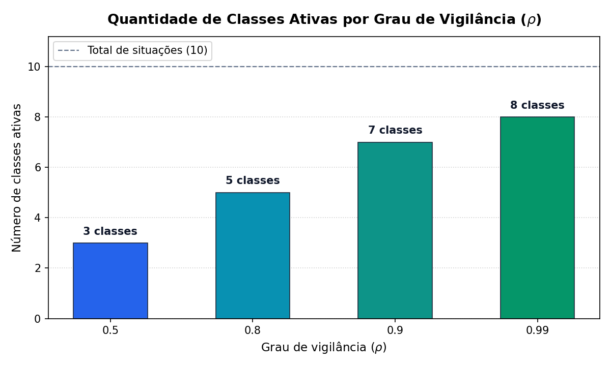
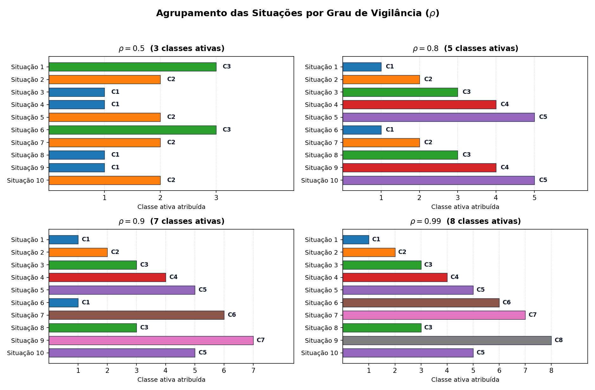
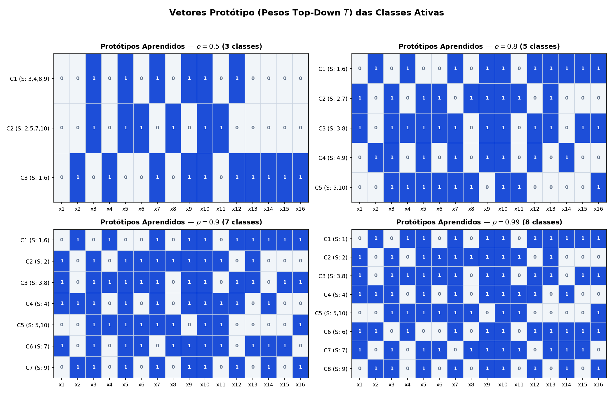
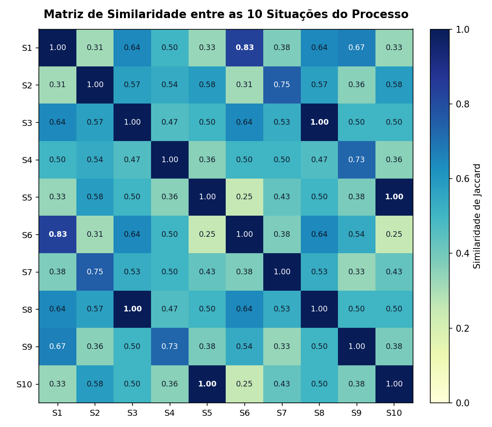

# Resolução da Atividade — Rede Neural ART-1

**Instituição:** CEFET-MG — Campus VIII (Varginha)  
**Curso:** Bacharelado em Sistemas de Informação  
**Disciplina:** Lab. Inteligência Artificial  
**Professor:** Lázaro Eduardo da Silva  
**Implementação:** [`art1.py`](./art1.py) | **Dados:** [`treinamento.csv`](./treinamento.csv), [`teste.csv`](./teste.csv)

---

## 1. Descrição do Modelo ART-1 Utilizado

Para agrupar as **10 situações** do processo industrial descritas por **16 variáveis binárias de status** ($x_1$ a $x_{16}$), foi implementada uma rede **ART-1** (*Adaptive Resonance Theory 1*) com os seguintes parâmetros:

- **Camada de entrada / comparação ($F_1$):** $n = 16$ neurônios.
- **Camada de reconhecimento ($F_2$):** até $m = 10$ neurônios de classe.
- **Parâmetro de escolha:** $L = 2{,}0$.
- **Inicialização dos pesos:**
  - *Bottom-up* ($F_1 \to F_2$): $b_{ij}(0) = \frac{1}{1 + n} = \frac{1}{17}$.
  - *Top-down* ($F_2 \to F_1$): $t_{ji}(0) = 1$.
- **Critério de vigilância:** um padrão $x$ entra em ressonância com o neurônio vencedor $j$ se:
  $$\frac{\|x \land t_j\|_1}{\|x\|_1} \ge \rho$$
  Caso contrário, ocorre *reset* do neurônio $j$ e a competição prossegue com os demais neurônios.
- **Critério de parada do treinamento:** convergência completa dos pesos *top-down* ($T^{(t)} = T^{(t-1)}$).

---

## 2. Resumo Comparativo das Simulações

| Grau de vigilância ($\rho$) | Épocas até convergência | Classes ativas | Agrupamentos (Situações) |
| :---: | :---: | :---: | :--- |
| **0.5** | 3 | **3** | `[3, 4, 8, 9]` \| `[2, 5, 7, 10]` \| `[1, 6]` |
| **0.8** | 2 | **5** | `[1, 6]` \| `[2, 7]` \| `[3, 8]` \| `[4, 9]` \| `[5, 10]` |
| **0.9** | 2 | **7** | `[1, 6]` \| `[2]` \| `[3, 8]` \| `[4]` \| `[5, 10]` \| `[7]` \| `[9]` |
| **0.99** | 2 | **8** | `[1]` \| `[2]` \| `[3, 8]` \| `[4]` \| `[5, 10]` \| `[6]` \| `[7]` \| `[9]` |

---

## 3. Resultados Detalhados por Grau de Vigilância

### 3.1. Simulação com $\rho = 0.5$
- **Épocas até a convergência:** 3
- **Quantidade de classes ativas:** **3**

| Classe ativa | Neurônio $F_2$ | Situações agrupadas | Vetor protótipo ($t_j$) |
| :---: | :---: | :--- | :---: |
| Classe 1 | #2 | Situação 3, Situação 4, Situação 8, Situação 9 | `0010101011010000` |
| Classe 2 | #3 | Situação 2, Situação 5, Situação 7, Situação 10 | `0010110101100000` |
| Classe 3 | #4 | Situação 1, Situação 6 | `0101001011011111` |

---

### 3.2. Simulação com $\rho = 0.8$
- **Épocas até a convergência:** 2
- **Quantidade de classes ativas:** **5**

| Classe ativa | Neurônio $F_2$ | Situações agrupadas | Vetor protótipo ($t_j$) |
| :---: | :---: | :--- | :---: |
| Classe 1 | #1 | Situação 1, Situação 6 | `0101001011011111` |
| Classe 2 | #2 | Situação 2, Situação 7 | `1010110111101000` |
| Classe 3 | #3 | Situação 3, Situação 8 | `1011111011011011` |
| Classe 4 | #4 | Situação 4, Situação 9 | `0110101011010100` |
| Classe 5 | #5 | Situação 5, Situação 10 | `0011111101100001` |

---

### 3.3. Simulação com $\rho = 0.9$
- **Épocas até a convergência:** 2
- **Quantidade de classes ativas:** **7**

| Classe ativa | Neurônio $F_2$ | Situações agrupadas | Vetor protótipo ($t_j$) |
| :---: | :---: | :--- | :---: |
| Classe 1 | #1 | Situação 1, Situação 6 | `0101001011011111` |
| Classe 2 | #2 | Situação 2 | `1010111111101000` |
| Classe 3 | #3 | Situação 3, Situação 8 | `1011111011011011` |
| Classe 4 | #4 | Situação 4 | `1110101011110100` |
| Classe 5 | #5 | Situação 5, Situação 10 | `0011111101100001` |
| Classe 6 | #6 | Situação 7 | `1010110111101110` |
| Classe 7 | #7 | Situação 9 | `0110101011010101` |

---

### 3.4. Simulação com $\rho = 0.99$
- **Épocas até a convergência:** 2
- **Quantidade de classes ativas:** **8**

| Classe ativa | Neurônio $F_2$ | Situações agrupadas | Vetor protótipo ($t_j$) |
| :---: | :---: | :--- | :---: |
| Classe 1 | #1 | Situação 1 | `0101101011011111` |
| Classe 2 | #2 | Situação 2 | `1010111111101000` |
| Classe 3 | #3 | Situação 3, Situação 8 | `1011111011011011` |
| Classe 4 | #4 | Situação 4 | `1110101011110100` |
| Classe 5 | #5 | Situação 5, Situação 10 | `0011111101100001` |
| Classe 6 | #6 | Situação 6 | `1101001011011111` |
| Classe 7 | #7 | Situação 7 | `1010110111101110` |
| Classe 8 | #8 | Situação 9 | `0110101011010101` |

---

## 4. Visualização dos Agrupamentos, Protótipos e Similaridade

### 4.1. Agrupamento das Situações por $\rho$

### 4.2. Vetores Protótipo ($T$) Aprendidos
Cada linha abaixo representa as variáveis de status em comum (`1`) entre as situações agrupadas na respectiva classe:

### 4.3. Matriz de Similaridade entre as Situações
A matriz de similaridade de Jaccard evidencia a estrutura natural dos dados:

---

## 5. Análise e Conclusão

- **Efeito do grau de vigilância ($\rho$):** quanto maior o valor de $\rho$, mais exigente se torna o critério de similaridade da rede ART-1, aumentando o número de classes ativas (3 → 5 → 7 → 8) e tornando os protótipos mais específicos.
- **Padrões idênticos:** as situações **3 e 8** e as situações **5 e 10** possuem vetores de status exatamente iguais (similaridade `1.00`), permanecendo agrupadas mesmo sob vigilância máxima ($\rho = 0.99$).
- **Diagnóstico para manutenção:**
  - Com **$\rho = 0.5$**, a rede realiza uma generalização ampla em **3 grandes grupos**, útil para triagem inicial, porém com protótipos mais esparsos.
  - Com **$\rho = 0.8$**, a rede captura os **5 pares naturais** de comportamento semelhante (`[1, 6]`, `[2, 7]`, `[3, 8]`, `[4, 9]` e `[5, 10]`), oferecendo o melhor equilíbrio entre generalização e especificidade para diagnóstico de manutenção.
  - Com **$\rho = 0.9$** e **$\rho = 0.99$**, a rede passa a separar situações com pequenas variações em poucas variáveis de status, aproximando-se de uma classificação individual de cada padrão distinto.
