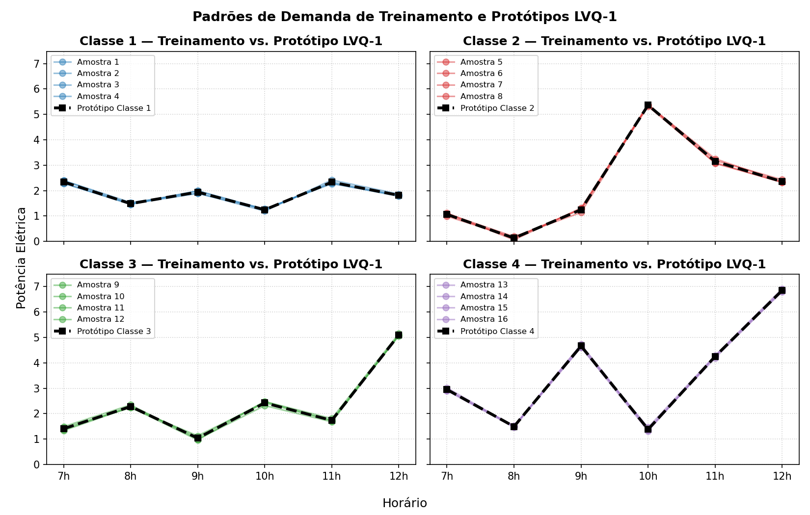
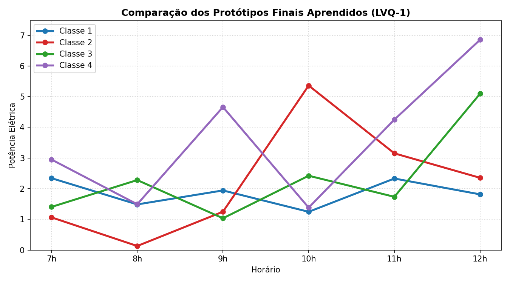
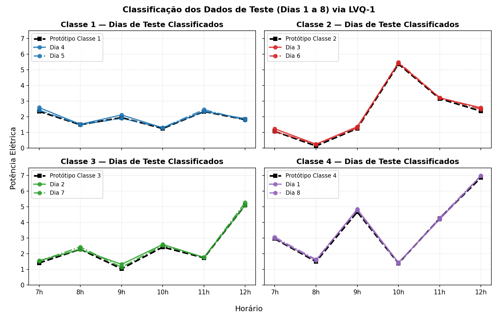

# Trabalho LVQ-1 — Classificação de Perfis de Potência Elétrica

**Disciplina:** Lab. Inteligência Artificial (CEFET-MG — Campus VIII, Varginha)  
**Algoritmo:** Learning Vector Quantization 1 (LVQ-1)  
**Código-fonte:** [`LVQ.py`](LVQ.py)

---

## 1. Configuração do Treinamento

- **Dados de treinamento:** 16 amostras (4 amostras por classe), com 6 atributos correspondentes à potência medida das 7h às 12h ([`treinamento.csv`](treinamento.csv)).
- **Protótipos:** 4 neurônios competitivos (1 protótipo por classe), inicializados com a primeira amostra de cada classe.
- **Taxa de aprendizagem inicial:** $\gamma = 0.05$ (com decaimento linear ao longo de 100 épocas).
- **Métrica de similaridade:** Distância euclidiana.
- **Acurácia no conjunto de treinamento:** **100,00%** (16/16 amostras classificadas corretamente).

---

## 2. Protótipos Finais Aprendidos (Pesos)

| Classe | 7 horas | 8 horas | 9 horas | 10 horas | 11 horas | 12 horas |
| :---: | :---: | :---: | :---: | :---: | :---: | :---: |
| **1** | 2.3416 | 1.4867 | 1.9422 | 1.2460 | 2.3309 | 1.8146 |
| **2** | 1.0639 | 0.1309 | 1.2492 | 5.3626 | 3.1517 | 2.3540 |
| **3** | 1.4053 | 2.2805 | 1.0353 | 2.4219 | 1.7345 | 5.0962 |
| **4** | 2.9490 | 1.4920 | 4.6618 | 1.3816 | 4.2520 | 6.8544 |

### Caracterização dos Padrões

- **Classe 1:** Demanda moderada e estável ao longo da manhã, oscilando entre ~1,25 e ~2,34.
- **Classe 2:** Mínimo acentuado às 8h (~0,13) seguido de pico expressivo às 10h (~5,36) e queda gradual até as 12h.
- **Classe 3:** Comportamento moderado das 7h às 11h (entre ~1,04 e ~2,42) com forte elevação às 12h (~5,10).
- **Classe 4:** Dois picos bem definidos — um às 9h (~4,66) e outro maior às 12h (~6,85) — com vales às 8h e 10h (~1,49 e ~1,38).

### Gráficos dos Padrões de Treinamento e Protótipos

---

## 3. Classificação dos Dados de Teste (Resposta Final)

A tabela abaixo apresenta a classificação obtida pela rede LVQ-1 para os 8 dias de teste ([`teste.csv`](teste.csv)):

| Dia | 7 horas | 8 horas | 9 horas | 10 horas | 11 horas | 12 horas | Classe | Distância ao Protótipo |
| :---: | :---: | :---: | :---: | :---: | :---: | :---: | :---: | :---: |
| **1** | 2.9817 | 1.5656 | 4.8391 | 1.4311 | 4.1916 | 6.9718 | **4** | 0.2404 |
| **2** | 1.5537 | 2.2615 | 1.3169 | 2.5873 | 1.7570 | 5.0958 | **3** | 0.3599 |
| **3** | 1.2240 | 0.2445 | 1.3595 | 5.4192 | 3.2027 | 2.5675 | **2** | 0.3195 |
| **4** | 2.5828 | 1.5146 | 2.1119 | 1.2859 | 2.3414 | 1.8695 | **1** | 0.3040 |
| **5** | 2.4168 | 1.4857 | 1.8959 | 1.3013 | 2.4500 | 1.7868 | **1** | 0.1606 |
| **6** | 1.0604 | 0.2276 | 1.2806 | 5.4732 | 3.2133 | 2.4839 | **2** | 0.2079 |
| **7** | 1.5246 | 2.4254 | 1.1353 | 2.5325 | 1.7569 | 5.2640 | **3** | 0.2934 |
| **8** | 3.0565 | 1.6259 | 4.7743 | 1.3654 | 4.2904 | 6.9808 | **4** | 0.2446 |

### Gráfico da Classificação dos Dados de Teste

