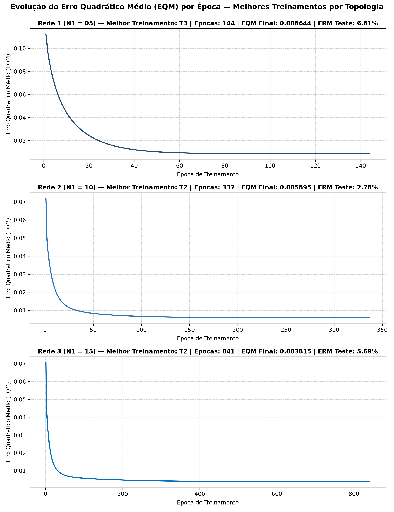

# Centro Federal de Educação Tecnológica de Minas Gerais - CEFET-MG
## Campus VIII – Varginha | Bacharelado em Sistemas de Informação
**Disciplina:** Lab. Inteligência Artificial  
**Professor:** Lázaro Eduardo da Silva  
**Trabalho:** Redes de Função de Base Radial (RBF 2) - Aproximação Funcional (Injeção Eletrônica)  
**Data:** 04/11/2026  

---

### Descrição do Problema
O objetivo deste trabalho é realizar o mapeamento não-linear (aproximação funcional) da quantidade de gasolina $\{y\}$ a ser injetada em tempo real por um sistema de injeção eletrônica automotiva em função de três grandezas de entrada $\{x_1, x_2, x_3\}$, utilizando **150 amostras de treinamento** (`treinamento_2.csv`) e **15 amostras de validação/teste** (`teste_2.csv`).

As três topologias candidatas avaliadas possuem 3 entradas, 1 neurônio linear na camada de saída e $N_1$ neurônios gaussianos na camada intermediária:
- **Rede 1:** RBF com $N_1 = 05$
- **Rede 2:** RBF com $N_1 = 10$
- **Rede 3:** RBF com $N_1 = 15$

---

## Atividade 1: Procedimento de Treinamento

O treinamento híbrido em dois estágios foi realizado para cada topologia da seguinte forma:
1. **Estágio 1 (Camada Intermediária — Não-Supervisionado):** Aplicação do algoritmo $k$-means sobre os 150 vetores de entrada $(x_1, x_2, x_3)$ para determinar os $N_1$ centros $\mu_j$ e suas respectivas variâncias $\sigma_j^2 = \frac{1}{|C_j|} \sum_{x \in C_j} \|x - \mu_j\|^2$, com função de ativação radial gaussiana:
   $$\phi_j(x) = \exp\left(-\frac{\|x - \mu_j\|^2}{2\sigma_j^2}\right)$$
2. **Estágio 2 (Camada de Saída — Supervisionado):** Execução de **3 treinamentos independentes (`T1`, `T2` e `T3`)** via Regra Delta Generalizada, reiniciando o gerador pseudoaleatório em cada treinamento (`seeds = 1, 2, 3`) para inicializar o vetor de pesos da camada de saída com valores distintos no intervalo $[0, 1]$, adotando taxa de aprendizado $\eta = 0.01$ e precisão $\epsilon = 10^{-7}$ ($|EQM(t) - EQM(t-1)| \le 10^{-7}$).

---

## Atividade 2: Resultados Finais dos Treinamentos

### Tabela 1: Valores Finais de EQM e Número de Épocas por Topologia

| Treinamento | Rede 1 ($N_1=05$) EQM | Rede 1 Épocas | Rede 2 ($N_1=10$) EQM | Rede 2 Épocas | Rede 3 ($N_1=15$) EQM | Rede 3 Épocas |
| :---: | :---: | :---: | :---: | :---: | :---: | :---: |
| **1º (T1)** | 0.008644 | 124 | 0.005895 | 323 | 0.003815 | 820 |
| **2º (T2)** | 0.008644 | 123 | 0.005895 | 337 | 0.003815 | 841 |
| **3º (T3)** | 0.008644 | 144 | 0.005895 | 358 | 0.003815 | 911 |

> **Observação Técnica:** Dentro de uma mesma topologia, os treinamentos `T1`, `T2` e `T3` atingem valores de EQM praticamente idênticos (diferindo apenas a partir da 7ª/8ª casa decimal), variando apenas no número de épocas até a convergência. Isso ocorre porque, uma vez fixadas as funções de base radial no Estágio 1, o neurônio de saída é linear e sua superfície de erro quadrático médio em relação aos pesos $W^{(2)}$ é **estritamente convexa** (um paraboloide com único mínimo global).

---

## Atividade 3: Validação das Redes no Conjunto de Teste

Para os 15 padrões do conjunto de teste (`teste_2.csv`), calculou-se o erro relativo percentual de cada amostra $k$ e sua respectiva média e variância:

$$ER_k(\%) = \frac{|d_k - y_k|}{|d_k|} \times 100\%, \qquad ERM(\%) = \frac{1}{15}\sum_{k=1}^{15} ER_k(\%), \qquad \text{Variância}(\%) = \frac{1}{15}\sum_{k=1}^{15}\left(ER_k(\%) - ERM(\%)\right)^2$$

### Tabela 2: Saídas Fornecidas pela Rede, Erro Relativo Médio (%) e Variância (%)

| Amostra | $x_1$ | $x_2$ | $x_3$ | $d$ | R1 $y(\text{T1})$ | R1 $y(\text{T2})$ | R1 $y(\text{T3})$ | R2 $y(\text{T1})$ | R2 $y(\text{T2})$ | R2 $y(\text{T3})$ | R3 $y(\text{T1})$ | R3 $y(\text{T2})$ | R3 $y(\text{T3})$ |
| :---: | :---: | :---: | :---: | :---: | :---: | :---: | :---: | :---: | :---: | :---: | :---: | :---: | :---: |
| **01** | 0.5102 | 0.7464 | 0.0860 | 0.5965 | 0.6081 | 0.6081 | 0.6081 | 0.5860 | 0.5860 | 0.5860 | 0.5915 | 0.5915 | 0.5915 |
| **02** | 0.8401 | 0.4490 | 0.2719 | 0.6790 | 0.7361 | 0.7362 | 0.7361 | 0.6750 | 0.6750 | 0.6750 | 0.6371 | 0.6371 | 0.6371 |
| **03** | 0.1283 | 0.1882 | 0.7253 | 0.4662 | 0.4363 | 0.4365 | 0.4364 | 0.4864 | 0.4864 | 0.4864 | 0.5089 | 0.5089 | 0.5089 |
| **04** | 0.2299 | 0.1524 | 0.7353 | 0.5012 | 0.4431 | 0.4432 | 0.4431 | 0.5041 | 0.5042 | 0.5042 | 0.5212 | 0.5212 | 0.5212 |
| **05** | 0.3209 | 0.6229 | 0.5233 | 0.6810 | 0.7019 | 0.7020 | 0.7018 | 0.6484 | 0.6484 | 0.6484 | 0.6643 | 0.6643 | 0.6643 |
| **06** | 0.8203 | 0.0682 | 0.4260 | 0.5643 | 0.5960 | 0.5958 | 0.5960 | 0.5323 | 0.5323 | 0.5323 | 0.5274 | 0.5274 | 0.5274 |
| **07** | 0.3471 | 0.8889 | 0.1564 | 0.5875 | 0.5434 | 0.5434 | 0.5434 | 0.5852 | 0.5852 | 0.5852 | 0.5967 | 0.5967 | 0.5967 |
| **08** | 0.5762 | 0.8292 | 0.4116 | 0.7853 | 0.8284 | 0.8286 | 0.8284 | 0.7588 | 0.7588 | 0.7588 | 0.7348 | 0.7348 | 0.7348 |
| **09** | 0.9053 | 0.6245 | 0.5264 | 0.8506 | 0.8244 | 0.8246 | 0.8244 | 0.8912 | 0.8912 | 0.8912 | 0.8165 | 0.8165 | 0.8165 |
| **10** | 0.8149 | 0.0396 | 0.6227 | 0.6165 | 0.5946 | 0.5944 | 0.5946 | 0.5945 | 0.5945 | 0.5945 | 0.6816 | 0.6816 | 0.6816 |
| **11** | 0.1016 | 0.6382 | 0.3173 | 0.4957 | 0.4633 | 0.4633 | 0.4633 | 0.5049 | 0.5049 | 0.5049 | 0.5309 | 0.5309 | 0.5309 |
| **12** | 0.9108 | 0.2139 | 0.4641 | 0.6625 | 0.6502 | 0.6500 | 0.6502 | 0.6155 | 0.6155 | 0.6155 | 0.5771 | 0.5771 | 0.5771 |
| **13** | 0.2245 | 0.0971 | 0.6136 | 0.4402 | 0.3715 | 0.3717 | 0.3715 | 0.4383 | 0.4384 | 0.4384 | 0.4703 | 0.4703 | 0.4703 |
| **14** | 0.6423 | 0.3229 | 0.8567 | 0.7663 | 0.7149 | 0.7148 | 0.7149 | 0.7578 | 0.7578 | 0.7578 | 0.7457 | 0.7457 | 0.7457 |
| **15** | 0.5252 | 0.6529 | 0.5729 | 0.7893 | 0.8824 | 0.8826 | 0.8824 | 0.8005 | 0.8005 | 0.8005 | 0.7568 | 0.7568 | 0.7568 |
| **Erro Relativo Médio (%)** | — | — | — | — | **6.61%** | **6.61%** | **6.61%** | **2.78%** | **2.78%** | **2.78%** | **5.69%** | **5.69%** | **5.69%** |
| **Variância (%)** *(pop.)* | — | — | — | — | **14.54%** | **14.45%** | **14.53%** | **4.38%** | **4.39%** | **4.39%** | **10.71%** | **10.71%** | **10.71%** |
| **Variância (%)** *(amostral)* | — | — | — | — | *15.58%* | *15.48%* | *15.57%* | *4.70%* | *4.70%* | *4.70%* | *11.48%* | *11.48%* | *11.47%* |

*(Com 4 casas decimais nos erros relativos médios: Rede 1 = `6.6108%`, `6.6116%`, `6.6101%`; Rede 2 = `2.7821%`, `2.7813%`, `2.7814%`; Rede 3 = `5.6907%`, `5.6907%`, `5.6909%`.)*

---

## Atividade 4: Gráficos de EQM em Função da Época de Treinamento

Selecionando o melhor treinamento de cada topologia (menor erro relativo médio de validação com mesmo patamar de EQM):
- **Rede 1 ($N_1 = 05$):** Treinamento **T3** (`ERM = 6.6101%`, `EQM = 0.008644`, `144 épocas`) — *(ou **T2** caso se priorize menor EQM exato `0.00864394` e menor nº de épocas `123`)*.
- **Rede 2 ($N_1 = 10$):** Treinamento **T2** (`ERM = 2.7813%`, `EQM = 0.005895`, `337 épocas`) — *(ou **T1** caso se priorize menor nº de épocas `323` e menor variância `4.3844%`)*.
- **Rede 3 ($N_1 = 15$):** Treinamento **T2** (`ERM = 5.6907%`, `EQM = 0.003815`, `841 épocas`).

Os três gráficos de evolução do Erro Quadrático Médio (EQM) por época foram gerados numa única folha de modo **não superposto** no arquivo `graficos_rbf2.png`:

---

## Atividade 5: Indicação da Topologia e Configuração Mais Adequada

Com base na análise conjunta dos resultados de treinamento (Item 2) e de generalização sobre o conjunto de validação/teste (Item 3), a arquitetura recomendada para o sistema de injeção eletrônica é:

> **Topologia Mais Adequada:** **Rede 2 ($N_1 = 10$ neurônios na camada escondida)**  
> **Configuração Final Recomendada:** **Treinamento T2** *(ou **T1**, dada a equivalência prática dos pesos no mínimo global e convergência ligeiramente mais rápida em 323 épocas)*.

### Justificativa Técnica:
1. **Superioridade na Capacidade de Generalização (Menor Erro e Menor Variância):**
   - A **Rede 2 ($N_1 = 10$)** alcançou o **menor Erro Relativo Médio no teste (`2.78%`)**, reduzindo o erro a menos da metade em comparação à Rede 1 (`6.61%`) e à Rede 3 (`5.69%`).
   - Além da precisão média superior, a Rede 2 obteve a **menor variância do erro (`4.39%`)**, garantindo regularidade e previsibilidade na dosagem de combustível em todos os regimes de operação do motor.

2. **Subajuste (*Underfitting*) na Rede 1 ($N_1 = 05$):**
   - Com apenas 5 funções de base radial para cobrir o espaço tridimensional $(x_1, x_2, x_3)$, a Rede 1 apresenta baixa capacidade de representação, resultando tanto no maior EQM de treinamento (`0.008644`) quanto no maior erro relativo médio (`6.61%`) e maior dispersão (`14.45%`) no teste.

3. **Sobreajuste (*Overfitting*) / Especialização Excessiva na Rede 3 ($N_1 = 15$):**
   - Embora a Rede 3 apresente o menor EQM sobre os dados de treinamento (`0.003815`), o seu desempenho de validação piora significativamente (`ERM = 5.69%`, `Variância = 10.71%`). Isso evidencia o fenômeno clássico de perda de generalização: ao dividir 150 amostras em 15 grupos menores, as variâncias $\sigma_j^2$ tornam-se estreitas demais, fazendo com que a rede memorize oscilações locais do conjunto de treino e generalize pior para amostras inéditas.

4. **Eficiência Computacional em Tempo Real:**
   - Como o sistema de injeção eletrônica opera embarcado e **em tempo real**, a Rede 2 exige um terço a menos de avaliações de funções exponenciais por ciclo de inferência do que a Rede 3 ($10$ contra $15$ neurônios ocultos), além de convergir em menos da metade das épocas no treinamento (~330 contra ~850 épocas).

